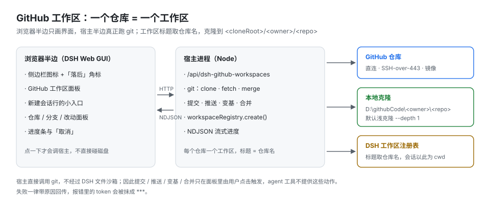
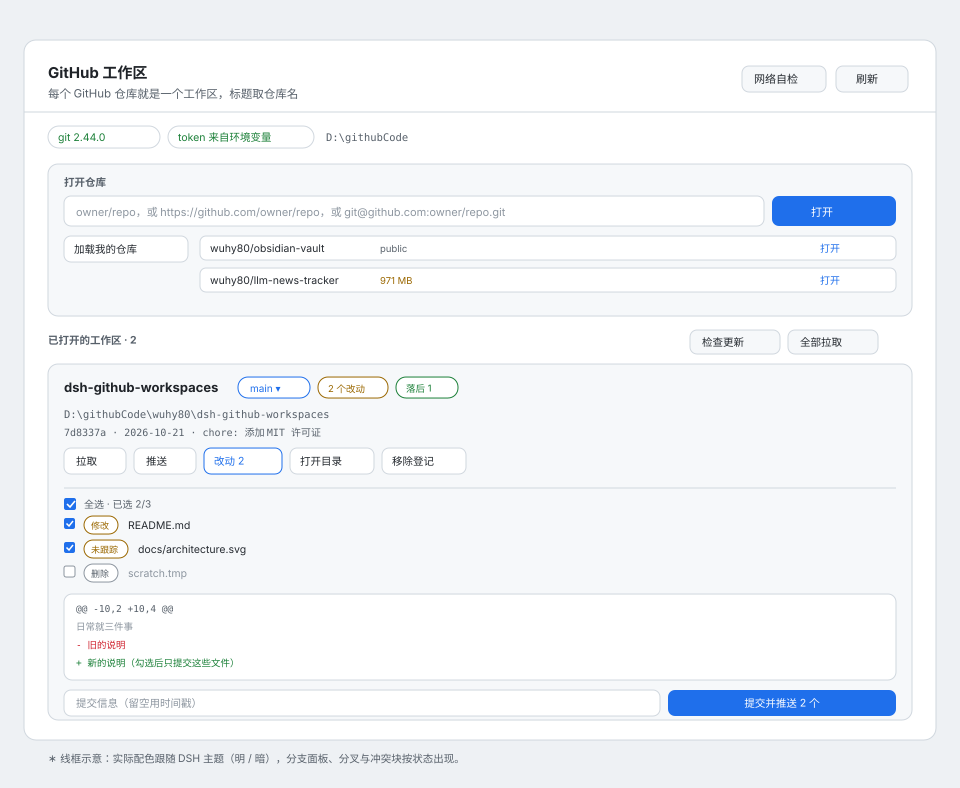
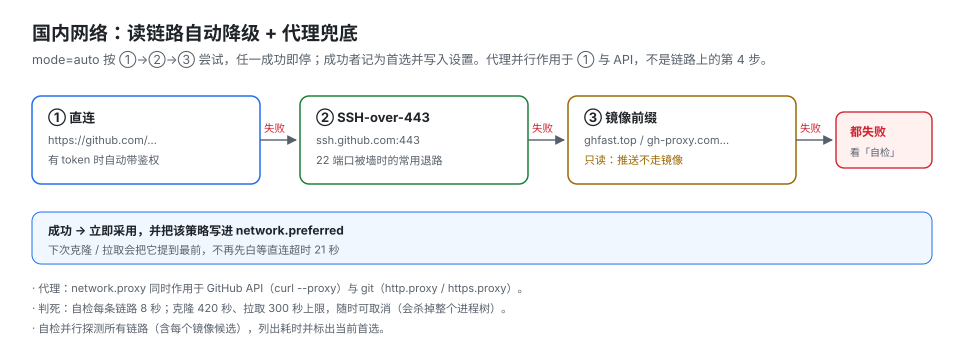

# GitHub 工作区（dsh-github-workspaces）

把 **GitHub 仓库当 DSH 工作区**：一个 GitHub 项目 = 一个工作区，工作区标题就是仓库名；
拉取、提交、推送都直接对 GitHub。为国内网络准备了自动降级的多条链路。MIT 许可。



## 一眼看懂

三个要点，看完就会用：

- **一个仓库 = 一个工作区**：点「打开」后它克隆到 `<cloneRoot>/<owner>/<repo>`（默认 `D:\githubCode`），
  并以**仓库名**登记成 DSH 工作区；之后在那个工作区里开会话，agent 的当前目录就是这份代码。
- **界面在浏览器，git 在宿主**：面板只负责点按与展示，真正跑 `git` 的是宿主进程；
  长任务（克隆 / 拉取 / 提交）都是流式进度，随时能取消。
- **改远端状态的动作只由你点**：提交、推送、变基、合并都不在 agent 工具里。



> 上面是**线框示意**（实际配色跟随 DSH 主题的明/暗）。真实截图还没补——运行中的 GUI 需要
> `dsh web` 打印的带 token 的地址才能打开，插件这边拿不到。

## 怎么用

### 第一次：把一个仓库变成工作区

1. 点侧边栏最底部的「GitHub 工作区」图标 → 面板。
2. 「**加载我的仓库**」——用你的 token 列出可见仓库（最多 300 个，含私有）。
3. 挑一个 → 「**打开**」→ 看着进度走完（会显示走的是直连还是 SSH-over-443，以及百分比）。
   也可以在输入框里直接贴 `owner/repo`、`https://github.com/owner/repo` 或 `git@github.com:owner/repo.git`。

完成后侧边栏的工作区列表里会出现同名工作区，直接在里面开新会话即可。

### 日常三件事

| 想做的事 | 在哪点 | 说明 |
|---|---|---|
| 看有没有更新 | 侧边栏图标上的橙点 | 有仓库落后才亮；60 秒刷新一次，只读本地不打网络 |
| 问远端真实情况 | 标题栏「**检查更新**」 | 只 fetch 不合并，回来告诉你几个落后、几个分叉 |
| 拉代码 | 卡片「拉取」或标题栏「**全部拉取**」 | 只做快进；分叉的原地不动 |
| 提交 | 卡片「**改动 N**」→ 勾选 → 「提交并推送」 | 只提交勾选的文件，不再 `add -A` |

点「改动」后面的文件名可以先看 diff：修改是 `+/-`，未跟踪文件直接显示内容，二进制与大文件只给提示。

### 网络拉不动的时候

按这个顺序试：

1. 标题栏「**检查更新**」——看哪条链路通、几个仓库落后。
2. 还是拉不下来（比如几百 MB 的仓库）：浏览器里 `Code → Download ZIP`，回到面板「打开仓库」卡片最下面，
   选文件、填 `owner/repo`、点「导入」。得到只读快照（没 `.git`），能读能改，**不能提交推送**。
   上游再更新时，重新下一份 zip，在卡片上点「刷新快照」增量覆盖即可。
3. 有本地代理客户端的话：设置里点「探测」，选一个端口即自动填好——**git 与 GitHub API 都会走它**，
   这是唯一能真正改吞吐的手段。

### 分叉了怎么办

拉取时会明确告诉你「已分叉：领先 1、落后 1」，然后卡片上出现两个按钮：

- **变基到远端** —— 把本地提交重放到远端之上，历史保持线性（推荐）。
- **合并远端** —— 产生一个合并提交。

冲突时列出冲突文件。面板里不能编辑文件，所以：在编辑器里解决 → 点「继续」；不想弄了 → 点「中止整合」回到原样。
整合完用「**推送**」把重写后的提交推上去。全程不会 reset、不会 force push。

### 让我（agent）来做

能说这些话：

- 「把 `wuhy80/llm-news-tracker` 打开成工作区」
- 「检查一下所有工作区有没有落后」
- 「把 dsh-github-workspaces 拉一下」
- 「网络自检一下，看现在走哪条链路」

对应的工具是 `github_workspace`，动作有 `list | status | open | pull | diagnose | repos`。
**提交和推送不在工具里** —— 刻意的，避免模型替你把东西推上去。

## 它做了什么

- **侧边栏新增「GitHub 工作区」面板**（侧边栏图标 + 中央整页），`/api/dsh-github-workspaces` 提供数据。
- **打开仓库 = 克隆 + 登记工作区**：克隆到 `<cloneRoot>/<owner>/<repo>`，然后
  `workspaceRegistry.create(path, 仓库名)`。标题只在新登记时使用，不会覆盖你手动改过的名字。
- **已打开的仓库卡片**：分支、未提交改动数、待推 / 待拉提交数、HEAD 摘要；可拉取、**按文件勾选提交**、打开目录、移除登记（保留文件）。
- **改动勾选 + 单文件 diff**：卡片上的「改动」展开文件列表（新增 / 修改 / 删除 / 重命名 / 未跟踪，重命名显示 `旧 → 新`），
  点文件名看该文件的 diff（未跟踪文件回内容本身，二进制与大文件只给提示），勾选后只提交这些文件——不再是 `add -A` 一把梭。
  提交与推送也走流式：暂存 → 提交 → 推送三段进度，可取消。
- **长任务有进度、可取消**：克隆、拉取、提交推送都走 NDJSON 流，面板显示当前阶段（直连 / SSH-over-443 / 镜像 / 合并 / 推送）与下载百分比，
  点「取消」会中止请求并由宿主杀掉 git 进程树。
- **分叉处理**：本地与远端都往前走了，拉取会明确报「已分叉」并更新待推/待拉数，卡片上出现
  **「变基到远端」/「合并远端」** 两个按钮（绝不自动选）；冲突时列出冲突文件并给 **「继续」/「中止整合」**，
  中止会把仓库恢复到整合前。整合完还能用 **「推送」** 把重写后的提交推上去。
- **分支**：点卡片上的分支名展开面板 —— 本地分支（带 `ahead/behind` 轨迹）可切换、可安全删除，
  远端分支可一键检出为本地跟踪分支，也能从当前 HEAD 新建分支；游离 HEAD 会被标成「游离 HEAD」，
  点开检出任一分支即可救回。删除只做 `git branch -d`，有未合并提交时明确拒绝，不提供强删。
- **批量与角标**：工作区列表标题栏有 **「检查更新」**（只 fetch，不合并）与 **「全部拉取」**（逐个体检+快进，
  分叉的原地不动、单独列出）。侧边栏图标上会出现一个橙色角标，表示「有仓库落后远端」——它由
  每 60 秒一次**只读本地**的 `/summary` 轮询驱动（单仓库一条 `git status -b`，不发网络请求，页面在后台时跳过），
  所以角标反映的是「上次抓取之后」的状态，想看远端真实情况点「检查更新」。
- **新建会话的入口**：新建会话那一行多了一个 `GitHub` 小按钮，点一下直达面板。
  （原本更自然的位置是工作区选择器下面那个 `directoryFlow` 洞，但它是 `single` 槽位、
  已被内置的目录选择器占着，注册进去会顶掉「选择目录」，所以只做增量入口。）
- **归档导入（只读快照）**：网络实在拉不动的大仓库，可以在浏览器里下载 zip，回面板导入。
  解压时用 Windows 自带的 `tar`（无额外依赖），单层目录会自动摊平，越界条目会被拒绝；
  导入结果是**没有 `.git` 的只读快照**——能读能改，但提交/推送/拉取/切分支都被守卫拒绝，卡片上标「只读快照」。
- **刷新快照**：上游更新后再下一份 zip，卡片上点「刷新快照」选它即可**增量覆盖**——
  只动上次导入过的文件（新的覆盖、新包里没有的删掉），**你自己在快照里建的文件不会被碰**。
- **本地代理探测**：设置里点「探测」，并发扫 `7890 / 1080 / 10808 / 8080 …` 等常见端口，
  用 SOCKS5 握手 + HTTP 响应区分 `socks5` / `http`，点一下就把 `network.proxy` 填好。
  注意：**浏览器扩展级代理探不到也接不上**（它只代理浏览器自身流量）。
- **agent 工具 `github_workspace`**：`list | status | open | pull | diagnose | repos`。

## 国内网络：自动降级 + 代理兜底

| 策略 | 做法 | 说明 |
|---|---|---|
| `direct` | `https://github.com/...` | 配了 token 时自动带上 `x-access-token` 鉴权 |
| `ssh443` | `git@github.com:...` 重写成 `ssh://git@ssh.github.com:443/` | 22 端口被封时通常还有救；需要本机 SSH key |
| `mirror` | `https://ghfast.top/https://github.com/...` | 只用于**读**；推送不走镜像 |
| `proxy` | 设 `network.proxy`（如 `http://127.0.0.1:7890`） | GitHub API 走 `curl --proxy`；**git 也会带上 `http.proxy` / `https.proxy`** |



`mode=auto`（默认）按 **直连 → SSH-over-443 → 镜像** 依次尝试；镜像候选内置
`ghfast.top` / `gh-proxy.com` / `ghproxy.net`。任何一次成功都会把该策略记为
**首选策略并写入设置**（`network.preferred`），重启后第一次克隆也不用再白等直连超时。
面板的「网络自检」并行探测每条链路（单条 8 秒判死），给出耗时与错误，并标出当前首选。

另外每个 git 调用都带 `core.longpaths`、`http.version=HTTP/1.1`，避免 Windows 长路径与
弱网下的 `RPC failed`；默认 `--depth 1 --single-branch` 浅克隆。

## 同步的正确性（0.2.0 修复）

两个曾经会让「拉取」直接失效、让「待推/待拉」永远错位的问题，现在都有回归测试兜着：

1. **fetch 不带 `--depth`**。带浅标记抓下来的新提交本身是浅边界（没有父提交），
   git 会判定它和本地 HEAD 无关，`merge --ff-only` 直接报
   `refusing to merge unrelated histories`。去掉 `--depth` 后仍保持浅克隆（测试里断言
   `rev-parse --is-shallow-repository` 仍为 `true`）。
2. **fetch 写显式 refspec、merge 合跟踪 ref、push 后补 `update-ref`**。
   按 URL fetch/push 不会更新 `refs/remotes/origin/*`，而 `ahead/behind` 正是拿
   `@{upstream}` 比的——不补这几步，拉完还会一直显示「待拉 N」。

## 安全边界

- 宿主进程直接调用 git，**不经过 DSH 文件沙箱**（与 dsh-ssh 调 ssh2 同级）。
- 因此**提交、推送、变基/合并都只在面板里由用户手动点击**：agent 工具不提供这些动作。
- 拉取默认只做快进（`merge --ff-only`）。分叉时**不会**自动变基或合并，而是把选择权交给用户；
  冲突时也不会替你解决或丢弃改动。**从不 reset、从不 force push**。
- 所有返回给前端/模型的报错都会把 token 抹成 `***`。
- 设置落在 `$DSH_HOME/dsh-github-workspaces.json`（权限 0600）；token 也可直接用环境变量
  `GITHUB_TOKEN` / `GH_TOKEN` / `GITHUB_PAT`（优先于文件）。

## 设置项

| 字段 | 默认 | 含义 |
|---|---|---|
| `token` | 空 | GitHub PAT（列私有仓库、推送需要）；环境变量优先 |
| `cloneRoot` | `D:\githubCode`（Windows）/ `~/dsh-github-workspaces` | 克隆根目录；不存在会自动创建 |
| `network.mode` | `auto` | `auto` / `direct` / `mirror` / `proxy` / `ssh443` |
| `network.mirror` | `https://ghfast.top/` | 镜像前缀 |
| `network.proxy` | 空 | 本地代理（API 与 git 都用） |
| `network.preferred` | 空 | 实测可用的读策略，auto 模式优先使用 |
| `network.apiBase` | `https://api.github.com` | 可替换为镜像 API |
| `author.name` / `author.email` | 空 | 提交身份；留空则读 git 全局配置，再留空会明确报错 |
| `clone.shallow` | `true` | 是否浅克隆 |

## 结构

```
index.js            宿主入口：注册路由 / 工具 / 提示段落
lib/store.js        设置与仓库登记（0600 JSON）
lib/proc.js         子进程包装（超时 / 取消 / 进度）、git 与 curl 探测
lib/git.js          克隆/状态/拉取/提交推送/网络自检 + 策略降级
lib/github.js       REST（仓库列表、身份）+ 仓库地址解析
lib/opener.js       仓库 → 工作区（先克隆，再登记）
lib/routes.js       /api/dsh-github-workspaces 路由族（loopback 门禁；open/pull/commit 为 NDJSON 流）
lib/tools.js        github_workspace 工具（标准 JSON Schema）
client.js           浏览器半边：sidebar.panellist + main 面板（含进度条与取消）
test/sync.test.mjs  同步路径回归测试（临时裸仓库，不碰网络）
```

## 测试

```bash
node --test test/sync.test.mjs
```

五条用例：fetch 参数不再带 `--depth`；浅克隆 + 远端前进 + 插件的 fetch/merge 序列能快进且
跟踪 ref 同步、仓库仍是浅克隆；推送到 URL 后补 `update-ref` 使 ahead 归零；超时后立即结算；
`AbortSignal` 中止会杀掉子进程并标记 `aborted`。

## 已知限制

- 浅克隆的仓库没有完整历史；需要时可手动 `git fetch --unshallow`。
- 镜像前缀只能读，推送必须直连或 SSH。
- diff 是纯文本展示（不做语法高亮/并排）；单文件超过 200 KB 会截断。
- 面板不需要 Cordis Config schema（设置走自己的面板），所以插件详情页里没有配置表单。
- 首次打开一个大仓库会慢；克隆超时 420 s，可随时取消。

## 变更日志

见 [CHANGELOG.md](CHANGELOG.md)。

## 许可证

[MIT](LICENSE) © 2026 wuhy80


